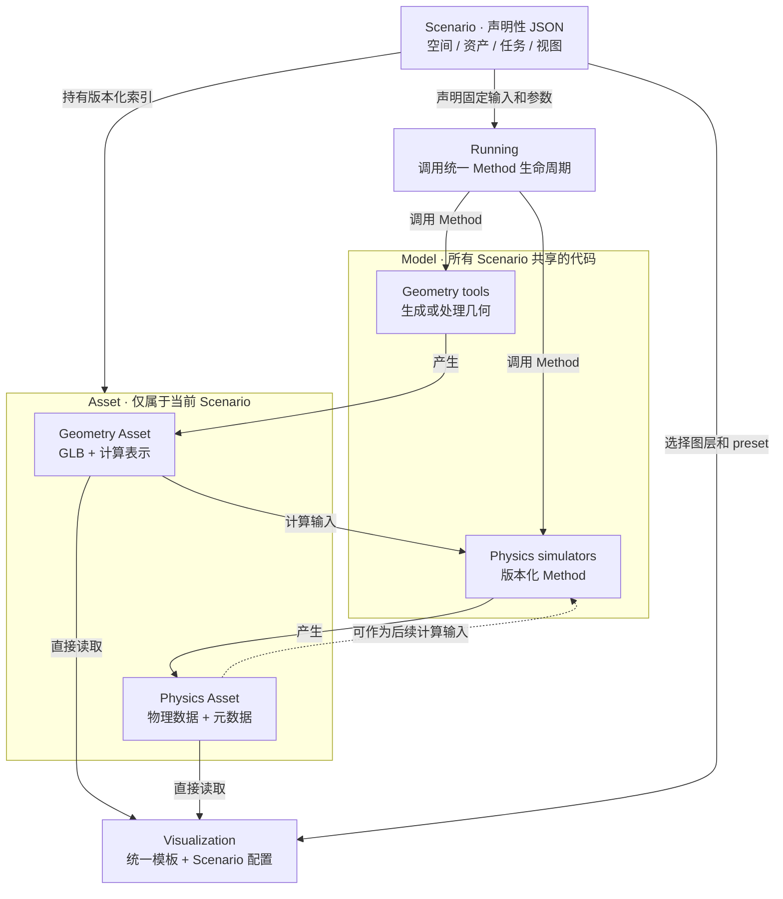
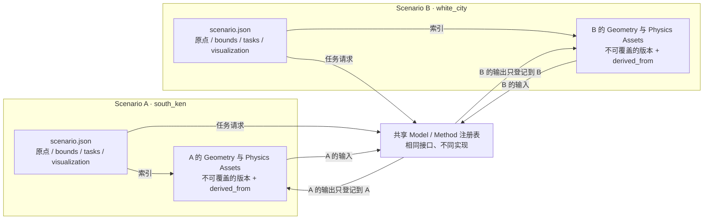
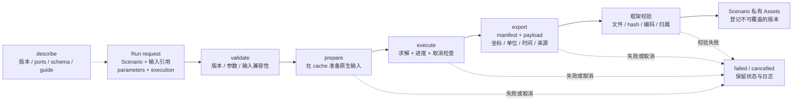
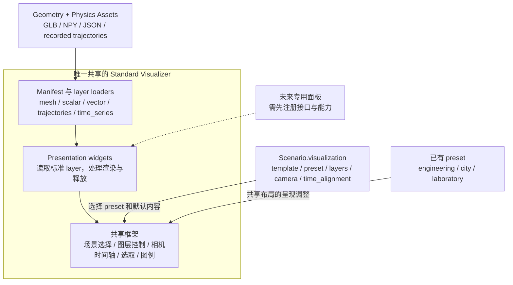

# CANOPY

Canopy 将城市仿真组织为 **Scenario / Asset / Model** 三个主体。Scenario 描述场景并拥有自己的资产；Model 是所有场景共享的计算工具；Asset 保存几何与物理结果。**Running 负责执行，Visualization 负责读取和呈现**，两者使用相同的数据契约。

## 1. 整体框架：三个主体、两个共享服务



Geometry 可以直接进入 Visualizer；Physics 可以依赖 Geometry，也可以依赖已有 Physics 结果。Visualizer 读取导出且校验过的结果，当前打开网页不会触发计算。Model 的原生求解器内部数据由适配器转换为标准资产；求解逻辑放在共享代码中。

## 2. 场景归属：共享工具，各自拥有资产



资产引用形如 `asset_id@1`，只在当前 Scenario 内解析。`derived_from` 固定输入资产版本；跨 Scenario 引用会被拒绝。新增场景主要增加声明性配置与场景私有数据；复用工具时无需复制求解器代码。

| 模块 | 必需内容 / 输入 | 产物 / 职责 |
| --- | --- | --- |
| **Scenario** | `scenario_id`、标题、ENU 原点与高程基准、bounds、资产索引、tasks、visualization | `project/<scenario>/scenario.json`；声明任务与视图，不执行脚本 |
| **Geometry Asset** | 来源与坐标、GLB 展示几何；依 Method 需要提供高度场、mask 等计算表示 | `*.asset.json` + `manifest.json` + `.glb` / `.npy` / `.json` |
| **Physics Asset** | 所属场景、输入版本、layer kind、数组 shape / axes / dtype、单位、空间采样、时间、缺失 mask | 标量场、向量场、轨迹或时间序列；记录 provenance 和校验和 |
| **Model / Method** | Model 身份；Method 版本、输入端口、参数 schema、依赖、输出类型、能力、运行指南、示例 | `describe / validate / prepare / execute / export`；输出自包含结果 |
| **Running** | 场景 ID、Model / Method / 版本、精确资产引用、参数、执行设备 | 状态、日志、数值诊断、来源快照；成功后登记资产 |
| **Visualization** | `template: standard`、preset、资产与 layer 选择、可见性、相机与时间模式 | 共享场景、图层控件、相机、时间轴、选择与图例 |

**持久化标准是 JSON + GLB + NPY。** Three.js 是查看器实现，Blender / Python 是生成工具。GLB 描述展示几何，不能自动替代求解器需要的计算网格。大型展示序列支持逐帧 NPY 按需读取；完整三维场可作为 artifact 保留，当前查看器显示明确导出的水平切片。数据规范见 [Protocol v2](docs/framework/protocol-v2.md)。

## 3. 每个 Method 使用同一执行接口



失败或取消的运行不登记资产。`--dry-run` 校验请求；`--no-retain` 将试跑结果留在 cache。数值有效性由 Method 的 diagnostics 与验收检查负责，文件格式校验本身不能证明物理精度。接入要求和运行命令见 [Method guide](docs/framework/method-guide.md)。

## 4. Visualizer：固定模板，场景配置小幅调整



每个 Scenario 配置展示哪些资产与 layer，以及默认相机和时间模式；三种 preset 复用同一布局与控件。当前配置不接受任意场景脚本或页面组件。未来需要专用面板时扩展共享 widget 接口，并为所有场景保留相同的装载、时间、选择和释放约定。当前能力和待迁移范围见 [Migration status](docs/framework/migration-status.md)。

## 快速运行

```sh
python -m venv .venv
.venv/bin/python -m pip install -e '.[physics,geometry]'
.venv/bin/canopy --root . models
.venv/bin/canopy --root . demo
.venv/bin/canopy --root . serve --port 8769
```

打开 `http://127.0.0.1:8769/` 选择场景，或直接打开 `http://127.0.0.1:8769/src/visualization/viewer/?scenario=demo`。`canopy --root . demo --physics temperature pollution` 可自动运行 geometry → wind → temperature / pollution 耦合示例。小型 CPU 示例使用移植的 Physics4D 求解代码，创建私有资产并通过共享查看器展示。它不代替真实城市输入和研究级有效性验证。

```text
src/canopy/
  scenario/           场景定义与索引
  assets/             资产校验、导入与打包
  models/specs/       Model / Method 契约与可信注册
  running/            统一运行生命周期
  visualization/      统一查看服务与场景 profile
src/urban_flow/       Physics4D 物理实现
src/urban_geometry/   Physics4D 几何工具
src/visualization/    共享 viewer / widgets / loaders
project/<scenario>/  scenario.json 与场景配置
<data_root>/project/<scenario>/assets/  场景私有结果
<cache_root>/        可删除的运行中间产物
```

在忽略提交的 `storage.local.json` 配置绝对 `data_root` / `cache_root`。Python wheel 打包共享实现和 schema；场景独立使用 `canopy pack SCENARIO /absolute/path/scenario.tar.gz` 打包。wheel 安装后使用 `canopy --root /path/to/checkout ...`，checkout 提供场景元数据、文档和静态查看器。

迁移已记录的 Physics4D 数据：

```sh
python tools/migrate_physics4d.py --source /path/to/physics4d --scene south_ken --scene white_city
canopy --root . validate south_ken
canopy --root . validate white_city
# Imperial Corridor 使用保留的 local_viewer_20261102 与来源报告：
python tools/migrate_imperial_corridor.py --source /path/to/local_viewer_20261102 --report /path/to/local_physics_20261102.json
```

- [数据与归属标准](docs/framework/protocol-v2.md)
- [每个 Method 的接口与运行指南](docs/framework/method-guide.md)
- [已实现范围与兼容入口](docs/framework/migration-status.md)
- [Geometry](docs/models/geometry-heightfield.md)、[GLB → Heightfield](docs/models/geometry-rasterize_glb.md)、[Solar](docs/models/solar-shadow.md)、[Flood](docs/models/flood-shallow_water.md)、[Wind](docs/models/wind-mac.md)、[Temperature](docs/models/temperature-finite_difference.md)、[Pollution](docs/models/pollution-steady_tracer.md)

检查接口与查看器：

```sh
python -m unittest discover -s tests -v
node --test tests/test_viewer.mjs
# Start canopy serve first; set PUPPETEER_MODULE and CHROME_PATH if needed.
node tests/browser_canopy.cjs http://127.0.0.1:8769
```

移植源码不等于每个历史研究脚本都已注册为 Method。正式接口以 `canopy models` 的输出为准；环境依赖和迁移状态有独立记录。现有公开网页保留如下兼容入口，部署与数据发布需要单独执行。

## Existing Imperial Corridor website

Physics Urban World — Imperial Corridor, London.

GitHub Pages serves the viewer and local vector assets. Original and compact physical data are stored in the upstream GitHub Release. A service worker routes large-asset requests through the existing CANOPY read-only data gateway for CORS compatibility. No full-dataset download or installation is required before entering Overview.

Open via HTTPS or a localhost server. Full building geometry is retained. Compact fields retain original sampled timestamps; spatial averaging smooths local extrema. Source provenance is included under scenes/imperial_corridor_8km/compact-provenance/.

The loading illustration is a stylized pixel-art campus, not a measured building model.

### Low-altitude UAV demo

Open `?shot=uavs` for 1,383 validated original WavePDE routes between 100 irregular synthetic stations, all shown in pale gold. **All routes** toggles the network; **100 stations** frames the domain; **At building** follows a selected avoidance example.

The solver grid is 4 × 4 × 4 m, with a 25 m AGL ceiling and 12 m takeoff/landing gates. Each station targets its nearest 30 destinations (3,000 directed attempts). Of these, 1,383 passed endpoint, original closed-voxel and independent 2 m terrain/building/tree-column checks. The displayed maximum is 22.95 m AGL. The 1,617 failed attempts remain in the retained run: 928 cycles, 264 blocked steps and 425 missing arrivals. The successful network connects all 100 stations. Station positions use seeded irregular sampling with at least 450 m separation, excluding buildings, trees, water and roads.

The original solver uses `gaussian_short`, a 0.1 s timestep, 4,000 steps, adaptive local crops and plain characteristic tracing. Native 8 m frozen wind at 7,500 s is interpolated onto the 4 m planner and transferred by height above terrain. This is not a new 4 m CFD simulation or a real flight validation. Kinematic replay time is separate from raw PDE first-peak time.

Browser paths are simplified for display with a maximum 0.25 m deviation and independently rechecked against the obstacle columns every 0.5 m. Full-resolution paths, arrival fields, failed attempts, source snapshot and provenance are retained on `ese-yl222` in `uav_wavepde_4m_20261111`. See `assets/uav-wavepde-4m-20261111/evidence.json`. Earlier exports remain archived in their original directories.
