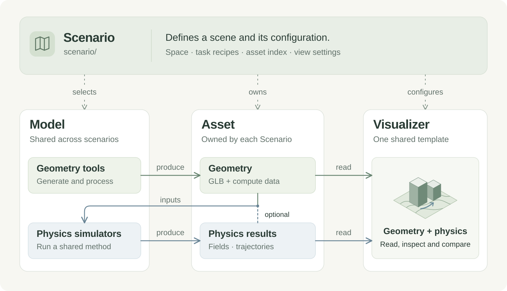

# Canopy

A framework for geometry, physics simulation and urban visualization.

**Scenario, Model and Asset are the three core concepts.** A Scenario defines a scene, selects shared Models and owns its Assets. Geometry tools produce Geometry; physics simulators consume Geometry and, when needed, previous results to produce Physics Assets. Each Scenario keeps its own geometry and results.

**Visualization is separate from execution.** The Visualizer reads Geometry and Physics Assets through one shared template. Scenario view settings choose the layers, camera and presentation preset; opening a view does not start a simulation.

| Directory | Responsibility | Explore |
| --- | --- | --- |
| [model/](model/README.md) | Shared geometry tools, physics simulators and execution interfaces | Methods, installation and run guides |
| [scenario/](scenario/README.md) | Scene identity, space, task recipes, asset references and view settings | Scene organization and examples |
| [asset/](asset/README.md) | Geometry and physics data contracts, with scenario-owned storage | Formats, provenance and packaging |
| [visualizer/](visualizer/README.md) | One viewer framework with scenario-specific presentation | Loaders, widgets and presets |

Each directory documents its internal structure and interfaces. Start with [Model setup](model/README.md#run-the-small-example) to run an example, or review the [London case](scenario/imperial_corridor_8km/README.md).
