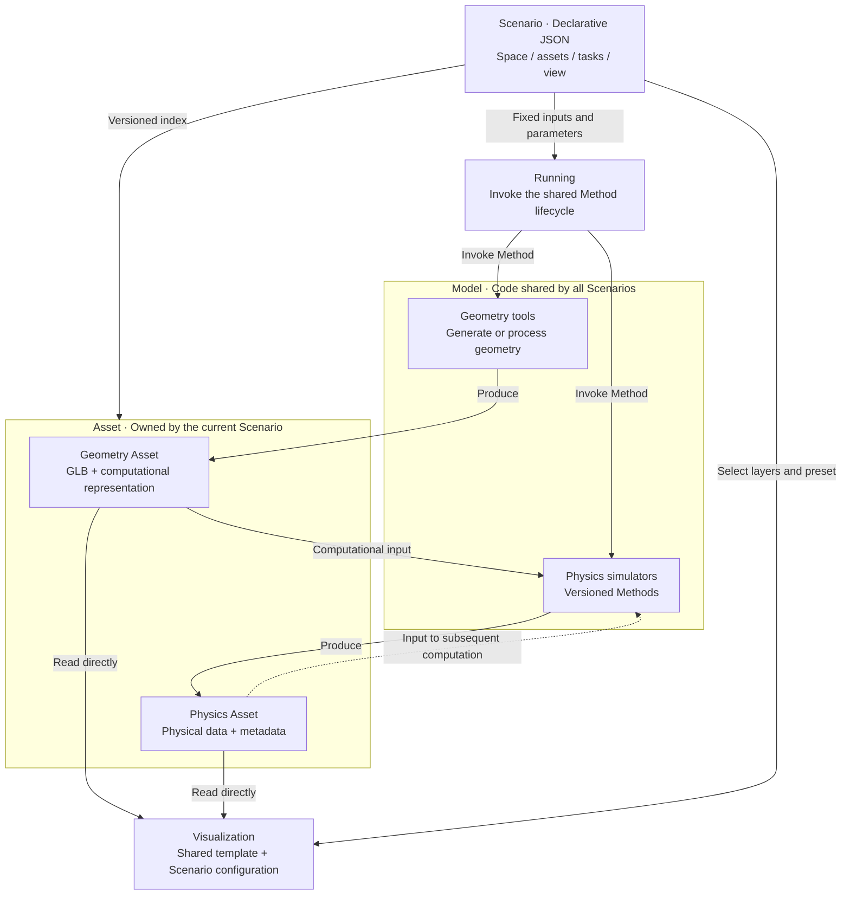
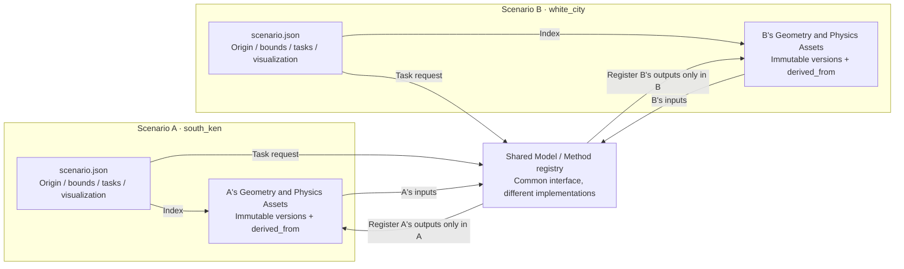
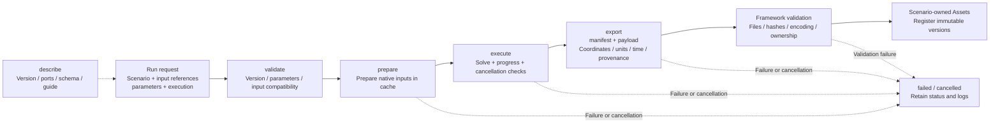
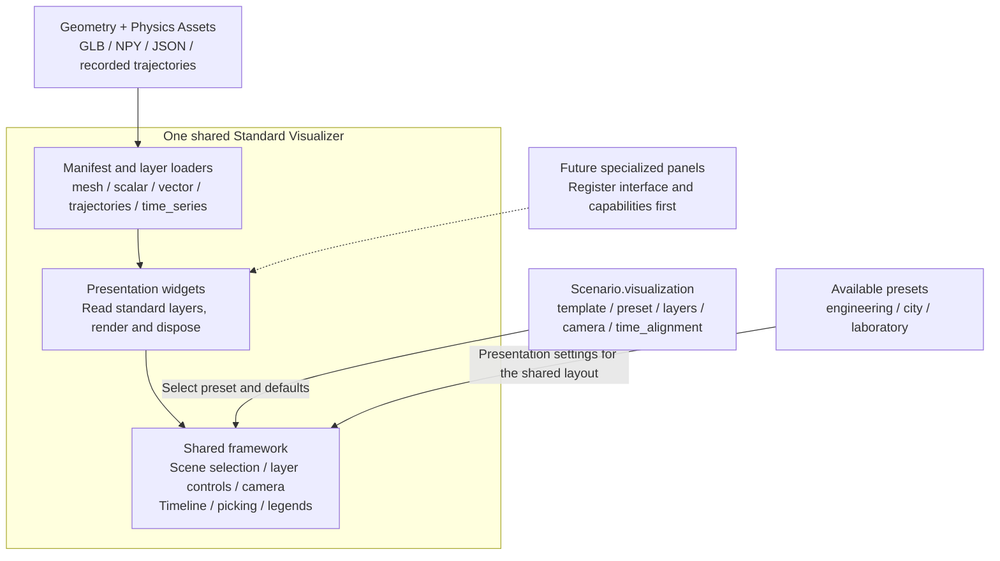

# CANOPY

Canopy is a physics simulation framework for urban environments. Build geometry, run physical models and explore recorded results through a shared visualizer.

The framework is organized around **Scenario / Asset / Model**. A Scenario describes a scene and owns its assets; Models are computational tools shared by all scenarios; Assets store geometry and physics results. **Running executes computations, and Visualization reads and presents results**, using the same data contract.

## Architecture



Geometry can go directly to the Visualizer. Physics can depend on geometry or on existing physics results. The Visualizer reads exported, validated results; opening the current viewer does not start a computation. Model adapters convert native solver data into standard assets, while solver logic stays in shared code.

## Scenarios and assets



Asset references such as `asset_id@1` resolve only within the current Scenario. `derived_from` pins input asset versions, and cross-scenario references are rejected. Adding a scenario primarily adds declarative configuration and private scene data; reusing a tool does not require copying its solver.

| Module | Required content / inputs | Outputs / responsibility |
| --- | --- | --- |
| **Scenario** | `scenario_id`, title, ENU origin and vertical datum, bounds, asset index, tasks, visualization | `project/<scenario>/scenario.json`; declares tasks and views without executing scripts |
| **Geometry Asset** | Provenance and coordinates, GLB display geometry, and computational representations such as a heightfield or mask as required by the Method | `*.asset.json` + `manifest.json` + `.glb` / `.npy` / `.json` |
| **Physics Asset** | Owning scenario, input versions, layer kind, array shape / axes / dtype, units, spatial sampling, time, missing-data mask | Scalar fields, vector fields, trajectories or time series, with provenance and checksums |
| **Model / Method** | Model identity; Method version, input ports, parameter schema, dependencies, output types, capabilities, run guide and example | `describe / validate / prepare / execute / export`; produces self-contained results |
| **Running** | Scenario ID, Model / Method / version, exact asset references, parameters, execution device | Status, logs, numerical diagnostics and source snapshot; registers assets after success |
| **Visualization** | `template: standard`, preset, asset and layer selection, visibility, camera and time mode | Shared scene, layer controls, camera, timeline, picking and legends |

**The storage standard is JSON + GLB + NPY.** Three.js implements the viewer; Blender / Python generate data. GLB describes display geometry and does not automatically replace a solver's computational grid. Large display sequences support loading NPY frames on demand. Full 3D fields can be retained as artifacts; the current viewer displays explicitly exported horizontal slices. See [Protocol v2](docs/framework/protocol-v2.md).

## Model execution



Failed or cancelled runs do not register assets. `--dry-run` validates a request; `--no-retain` leaves trial results in cache. Each Method's diagnostics and acceptance checks assess numerical validity; file-format validation alone cannot establish physical accuracy. See the [Method guide](docs/framework/method-guide.md) for integration requirements and commands.

## Visualization



Each Scenario selects assets and layers, a default camera and a time mode. All three presets reuse the same layout and controls. Configuration does not accept arbitrary scene scripts or page components. Specialized panels must extend the shared widget interface and preserve common loading, time, picking and disposal conventions. See [Supported capabilities](docs/framework/migration-status.md) for model and viewer coverage.

## Quick start

```sh
python -m venv .venv
.venv/bin/python -m pip install -e '.[physics,geometry]'
.venv/bin/canopy --root . models
.venv/bin/canopy --root . demo
.venv/bin/canopy --root . serve --port 8769
```

Open `http://127.0.0.1:8769/` to select a scenario, or go directly to `http://127.0.0.1:8769/src/visualization/viewer/?scenario=demo`. Run `canopy --root . demo --physics temperature pollution` for an automatic geometry → wind → temperature / pollution example. This small CPU example uses the imported Physics4D solvers, creates scenario-owned assets and displays them in the shared viewer. Real city inputs and research validation require separate preparation.

```text
src/canopy/
  scenario/           Scenario definitions and indexes
  assets/             Asset validation, import and packaging
  models/specs/       Model / Method contracts and trusted registration
  running/            Shared execution lifecycle
  visualization/      Shared viewer service and scenario profiles
src/urban_flow/       Physics4D physics implementations
src/urban_geometry/   Physics4D geometry tools
src/visualization/    Shared viewer / widgets / loaders
project/<scenario>/  scenario.json and scenario configuration
<data_root>/project/<scenario>/assets/  Scenario-owned results
<cache_root>/        Disposable run intermediates
```

Configure absolute `data_root` / `cache_root` paths in the Git-ignored `storage.local.json`. The Python wheel packages shared implementations and schemas. Package scenarios separately with `canopy pack SCENARIO /absolute/path/scenario.tar.gz`. After installing the wheel, use `canopy --root /path/to/checkout ...`; the checkout supplies scenario metadata, documentation and the static viewer.

Recorded Physics4D scenes can be imported with their original samples, coordinates and provenance. See [Scene import](docs/framework/migration-status.md#importing-recorded-scenes) for commands and input requirements.

## Documentation

- [Data and ownership standard](docs/framework/protocol-v2.md)
- [Method interfaces and run guides](docs/framework/method-guide.md)
- [Supported models, scenarios and compatibility](docs/framework/migration-status.md)
- [Geometry](docs/models/geometry-heightfield.md), [GLB → Heightfield](docs/models/geometry-rasterize_glb.md), [Solar](docs/models/solar-shadow.md), [Flood](docs/models/flood-shallow_water.md), [Wind](docs/models/wind-mac.md), [Temperature](docs/models/temperature-finite_difference.md), [Pollution](docs/models/pollution-steady_tracer.md)

## Validation

Check the interfaces and viewer:

```sh
python -m unittest discover -s tests -v
node --test tests/test_viewer.mjs
# Start canopy serve first; set PUPPETEER_MODULE and CHROME_PATH if needed.
node tests/browser_canopy.cjs http://127.0.0.1:8769
```

`canopy models` is the authoritative interface catalog. Each registered Method describes its accepted inputs, parameters, outputs, dependencies and run guide. [Verification records](docs/framework/verification.md) document the checks performed and their scope.

## Imperial Corridor, London

Physics Urban World — Imperial Corridor, London.

GitHub Pages serves the viewer and local vector assets. Original and compact physical data are stored in the upstream GitHub Release. A service worker routes large-asset requests through the existing CANOPY read-only data gateway for CORS compatibility. No full-dataset download or installation is required before entering Overview.

Open via HTTPS or a localhost server. Full building geometry is retained. Compact fields retain original sampled timestamps; spatial averaging smooths local extrema. Source provenance is included under scenes/imperial_corridor_8km/compact-provenance/.

The loading illustration is a stylized pixel-art campus, not a measured building model.

### Low-altitude UAV demo

Open `?shot=uavs` for 1,383 validated original WavePDE routes between 100 irregular synthetic stations, all shown in pale gold. **All routes** toggles the network; **100 stations** frames the domain; **At building** follows a selected avoidance example.

The solver grid is 4 × 4 × 4 m, with a 25 m AGL ceiling and 12 m takeoff/landing gates. Each station targets its nearest 30 destinations (3,000 directed attempts). Of these, 1,383 passed endpoint, original closed-voxel and independent 2 m terrain/building/tree-column checks. The displayed maximum is 22.95 m AGL. The 1,617 failed attempts remain in the retained run: 928 cycles, 264 blocked steps and 425 missing arrivals. The successful network connects all 100 stations. Station positions use seeded irregular sampling with at least 450 m separation, excluding buildings, trees, water and roads.

The original solver uses `gaussian_short`, a 0.1 s timestep, 4,000 steps, adaptive local crops and plain characteristic tracing. Native 8 m frozen wind at 7,500 s is interpolated onto the 4 m planner and transferred by height above terrain. This is not a new 4 m CFD simulation or a real flight validation. Kinematic replay time is separate from raw PDE first-peak time.

Browser paths are simplified for display with a maximum 0.25 m deviation and independently rechecked against the obstacle columns every 0.5 m. Full-resolution paths, arrival fields, failed attempts, source snapshot and provenance are retained on `ese-yl222` in `uav_wavepde_4m_20261111`. See `assets/uav-wavepde-4m-20261111/evidence.json`. Earlier exports remain archived in their original directories.
