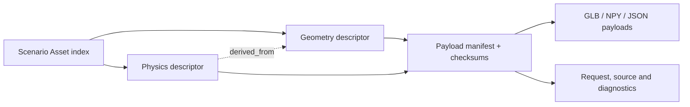

# Asset

[Canopy](../README.md) / Asset

Before adding a feature, read the [Asset contribution standard](CONTRIBUTING.md). [All component standards](../model/docs/framework/contributing.md) provide the shared entrypoint.

An Asset is a versioned, Scenario-owned Geometry or Physics result. Its small JSON descriptor identifies the payload, exact input versions, coordinates, provenance and file checksums. Bulk arrays and meshes remain separate binary files.

## Internal structure



One computation may produce both geometry and physics descriptors over a shared bundle. The bundle stores large payload files once. A descriptor selects its relevant manifest layers; each display layer has its own kind, sampling and encoding. A Layer is a typed part of an Asset, rather than a simulator implementation.

## Formats

| Data | Encoding | Required meaning |
| --- | --- | --- |
| Display geometry | Self-contained glTF 2.0 GLB | Y-up `(east, up, -north)`; node/entity mapping when exported |
| Computational geometry | NPY grids + `heightfield.json` | Shape, spacing, origin, sample location, height and solid/coverage masks |
| Scalar and vector fields | Little-endian, C-order NPY or per-frame NPY | Dtype, axes, units, grid, actual timestamps and missing-data mask |
| Recorded trajectories | JSON sparse frames | Entity IDs and positions at each actual sample; missing entities remain missing |
| Small examples / series | JSON | Explicit positions, channels, values and sampling semantics |
| Asset descriptor | JSON V2 | Owner, ID, version, kind, `derived_from`, provenance, files and payload selection |
| Payload manifest | JSON V1.1 | Layer encodings, coordinates, time, artifacts and execution provenance |

The [data protocol](../model/docs/framework/protocol-v2.md) is normative. [Schemas](schemas/README.md) define the machine-readable interfaces. The V2 Asset envelope embeds a reference to the established V1.1 payload; the two document types are validated separately.

Geometry for display is distinct from geometry required for computation. A Method requiring a heightfield cannot consume an arbitrary GLB without an explicit conversion. A physics input must match its selected geometry version and sampling domain. Three.js renders the stored data; Blender/Python scripts may generate it.

Current display arrays use YX/CYX/TYX/TCYX layouts. Full wind, temperature and tracer volumes can be retained as separate artifacts; the viewer currently displays explicitly exported horizontal slices. Zarr and arbitrary unstructured or dynamic meshes are not implemented.

## Storage

```text
asset/
  schemas/                         # Versioned interface schemas, tracked in Git
  data/                            # Default private data root, ignored by Git
    project/<scenario>/assets/
      bundles/<run_id>/
        geometry.asset.json        # Present when the bundle includes geometry
        physics.asset.json         # Present when it includes physics
        manifest.json
        *.glb / *.npy / *.json
        provenance/
```

Override `data_root` and `cache_root` with absolute paths in the ignored root `storage.local.json`. Scenario metadata remains in `scenario/<id>/`; scratch output goes to `<cache_root>/<scenario>/<model>/<run_id>/`. Original Physics4D checkouts retain their older `project/` metadata layout through the storage adapter.

Asset references resolve only inside the owning Scenario. Files cannot escape their storage boundary through paths or symlinks. Retained Assets are immutable: a new computation registers a new reference. `derived_from` pins the exact input versions, and SHA-256 checksums protect the payload. Historical unknown relationships stay unknown.

## Package a Scenario

```sh
canopy --root . validate imperial_corridor_8km
canopy --root . pack imperial_corridor_8km /absolute/output/london.tar.gz
```

The archive contains the complete Scenario index, registered Assets and provenance, excluding cache. It does not publish data. The destination must be outside the Asset directory and must not already exist.

Archives keep the portable `project/<scenario>/...` member layout. On restoration, place `scenario.json` under the checkout's `scenario/<scenario>/` directory and the retained data under `<data_root>/project/<scenario>/`. Exact references and payload paths remain unchanged.

For local retention, remote distribution and future large-array formats, see the [storage strategy](docs/storage.md). The [London Asset catalog](../scenario/imperial_corridor_8km/asset-catalog.json) lists the current retained bundle metadata.
