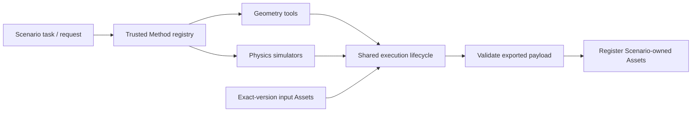

# Model

[Canopy](../README.md) / Model

Before adding a feature, read the [Model contribution standard](CONTRIBUTING.md). [All component standards](../model/docs/framework/contributing.md) provide the shared entrypoint.

Models provide reusable geometry tools and physics simulators. Every Scenario uses the same trusted registry; inputs and outputs belong to the selected Scenario. A Model groups related Methods, each with a versioned contract, parameter schema, example request and run guide.

## Internal structure



The execution service calls `describe → validate → prepare → execute → export`. Validation reads inputs; preparation and computation use disposable cache; only a complete, validated export becomes a retained Asset. Running and rendering have independent lifecycles.

| Location | Responsibility |
| --- | --- |
| [src/canopy/models/](src/canopy/models/) | Method interface, registry, JSON specs and adapters |
| [src/canopy/running/](src/canopy/running/) | Execution, cancellation, diagnostics and source snapshots |
| [src/canopy/](src/canopy/) | Shared Python SDK, including Scenario/Asset access and read-only viewer API |
| [src/urban_geometry/](src/urban_geometry/) | Imported geometry implementation |
| [src/urban_flow/](src/urban_flow/) | Imported physics implementation and reusable transport kernels |
| [tools/](tools/) | Contract validation and recorded-scene import tools |
| [tests/](tests/) | Python behavior and numerical regression checks |
| [docs/framework/](docs/framework/) | Integration standards, compatibility boundaries and provenance inventories |

Python import names stay stable (`canopy`, `common`, `urban_flow`, `urban_geometry`, etc.). The SDK lives beside the shared Models so that one wheel can install the execution interfaces. Browser code lives under [Visualizer](../visualizer/README.md), while actual scene metadata and payloads live under Scenario and Asset storage.

## Registered Methods

| Model | Method and run guide | Required inputs | Output |
| --- | --- | --- | --- |
| Geometry | [heightfield](geometry/heightfield/README.md) | Synthetic domain parameters | GLB, heightfield and solid mask |
| Geometry | [rasterize_glb](geometry/rasterize_glb/README.md) | Geometry Asset containing a GLB | Original GLB, sampled heightfield and coverage mask |
| Solar | [shadow](solar/shadow/README.md) | Geometry with a heightfield | Irradiance and shadow |
| Flood | [shallow_water](flood/shallow_water/README.md), NN4PDEs Linear | Geometry with height and solid grids | Water depth and ENU velocity from the pinned upstream solver |
| Wind | [mac](wind/mac/README.md) | Geometry with a heightfield | Velocity slices, full volume and native MAC faces |
| Temperature | [finite_difference_numpy](temperature/README.md) | Geometry + wind derived from that geometry | Temperature slice and full volume |
| Temperature | [finite_difference_torch](temperature/README.md) | The same geometry + wind contract | Temperature slice and full volume |
| Pollution | [steady_tracer](pollution/steady_tracer/README.md) | Geometry + native MAC wind faces | Steady tracer concentration |

`canopy models` lists the current registered interfaces. Additional imported research code is described in the [compatibility inventory](docs/framework/migration-status.md); it is not automatically a registered Method.

`flood/shallow_water@2.0.0` runs the original NN4PDEs AI4SWE Linear numerical kernel through a Canopy adapter. Its [upstream source record](src/canopy/models/vendor/nn4pdes/SOURCE.json) pins the authors' commit and file hashes. Version 1 used the separate Physics4D C-grid implementation; historical Assets retain that provenance and are not recomputed by this change.

## Run the small example

Run these commands from the repository root with Python 3.11 or newer:

```sh
python3 -m venv .venv
. .venv/bin/activate
python -m pip install -e '.[physics,geometry]'
canopy --root . models
python model/tools/run_example.py --physics solar flood wind temperature pollution
# The tool prints a separate workspace. The main checkout keeps only London.
# Validation below requires the local London payloads.
canopy --root . validate imperial_corridor_8km
canopy --root . serve --port 8769
```

Open <http://127.0.0.1:8769/>. The example generates synthetic geometry and results inside a disposable workspace. To view it, use the printed `canopy --root /path/to/workspace serve` command. The main checkout serves London. Use `python model/tools/run_example.py --physics` for geometry only. CPU execution is the default; device requirements and physical assumptions are specified in each Method guide.

For a single Method, copy a request from [model/tests/fixtures/canopy](tests/fixtures/canopy/), set the Scenario and exact input Asset references, then run `canopy --root /path/to/example-workspace run REQUEST.json --dry-run` followed by the same command without `--dry-run`. A saved recipe can also run through `canopy run-task SCENARIO TASK`.

## Add or change a Method

Follow the [Method interface and execution standard](docs/framework/method-guide.md). Register the adapter, declare compatible computational representations, supply a strict parameter schema and a runnable example, and document expected outputs, diagnostics and resource limits. Solvers write through the shared execution context; widgets only present results.

The [data protocol](docs/framework/protocol-v2.md) defines ownership, coordinates and payloads. The [Physics4D source inventory](docs/framework/physics4d-import.json) preserves original file hashes; [import adaptations](docs/framework/import-adaptations.json) records relocation and subsequent changes.

## Verify and package

From the repository root, after installation:

```sh
python -m unittest discover -s model/tests -v
python model/tools/check_contract.py model/tests/fixtures/contract-v1/manifest.json
node --test visualizer/tests/test_viewer.mjs
python -m pip wheel --no-deps . -w dist
```

The wheel contains shared Python implementations, Method specifications and schemas. Use an explicit metadata checkout after installation: `canopy --root /path/to/canopy ...`. The checkout supplies Scenario configuration and browser resources. Package a Scenario and its retained Assets separately with `canopy pack`; see [Asset packaging](../asset/README.md#package-a-scenario).

See the [verification record](docs/framework/verification.md) for checks and their limits.

For explicit retained-input SUMO collision experiments, see the [diagnostic guide](traffic/diagnostic/README.md). This tool is experimental and is not a registered Method.

The [native traffic demo guide](traffic/demo/README.md) documents reproducible OSM/SUMO preparation, retained inputs and bounded acceptance checks.

The [transient traffic pollution Method](pollution/traffic_transient/README.md) couples explicit SUMO PMx mass emissions to a pressure-projected frozen wind volume. It exports a conditional concentration increment, not calibrated total PM2.5.

## Healthy-route research

The [health model](healthy_route/README.md) includes weights and a runnable, participant-free inference example with standard local-viewer layers. Personalized route optimization remains a separate private-input workflow; its extended London replay is opt-in.

## Recorded external-solver cases

The [LISFLOOD-FP SK case utility](flood/lisflood_fp/README.md) verifies, builds, reruns and audits a frozen-input research experiment. It is separate from the registered Methods and does not change the existing flood adapter.
