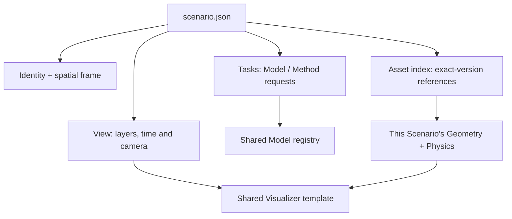

# Scenario

[Canopy](../README.md) / Scenario

Before adding a feature, read the [Scenario contribution standard](CONTRIBUTING.md). [All component standards](../model/docs/framework/contributing.md) provide the shared entrypoint.

A Scenario is a declarative JSON description of a scene. It records spatial meaning, references its own Assets, pins computation recipes and configures the shared Visualizer. Loading a Scenario does not execute a Blender script, Three.js program or simulator.

## Internal structure



| Field | Contract |
| --- | --- |
| `schema_version` | `2.0.0` |
| `scenario_id`, `title` | Stable canonical identity and human-readable name |
| `spatial` | ENU metres, geographic origin, vertical datum and domain bounds; synthetic scenes explicitly set `georeferenced:false` |
| `assets` | Exact-version reference → Asset descriptor path, relative to this Scenario's retained data directory |
| `tasks` | Named requests pinning Model, Method, version, inputs, parameters and execution settings |
| `visualization` | `standard` template, preset, selected Asset/layer pairs, time alignment and optional camera |
| `legacy` | Optional link and description for a compatibility presentation |

The complete schema is [scenario-v2.schema.json](../asset/schemas/scenario-v2.schema.json). Scenario identity, referenced assets and task ownership are checked together by the SDK. There is no implicit `latest` result.

## Directory and ownership

```text
scenario/
  imperial_corridor_8km/
    scenario.json             # The only curated Scenario
    migration.json            # Import provenance
    asset-catalog.json        # Generated review metadata, no raw payloads
    README.md
```


Geometry and physics payloads are stored separately under `<data_root>/project/<scenario>/assets/`. The default data root is `asset/data/`. Each Scenario owns its geometry and results; reusable Model implementations and the Visualizer template are shared. See [Asset storage](../asset/README.md#storage).

View is the `visualization` section of a Scenario, not a fourth core data concept. The supported presets are `engineering`, `city` and `laboratory`; the template, widget interfaces and loading rules stay consistent.

## Work with the London case

The only curated Scenario is [Imperial Corridor, London](imperial_corridor_8km/README.md). Its nine registered Assets include seven historical bundles and two crop/solar verification bundles; the standard view selects nine historical layers.

```sh
canopy --root . validate imperial_corridor_8km
canopy --root . serve --port 8769
```

Metadata is included in Git. Private retained payloads must be supplied locally or imported explicitly; copying `scenario.json` alone does not copy the dataset. The [London import guide](../model/docs/framework/migration-status.md#importing-recorded-scenes) describes the required sources. Historical full-domain task recipes are not yet migrated.

## Development fixtures

Small protocol examples and Method request templates live under [model/tests/fixtures](../model/tests/fixtures/README.md). Run `python model/tools/run_example.py` to create a synthetic example in a disposable metadata workspace under cache. It prints the workspace path for subsequent `canopy --root ...` commands. Synthetic tests do not add entries to the curated London catalog.
