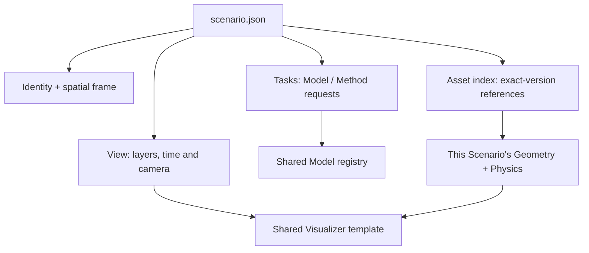

# Scenario

[Canopy](../README.md) / Scenario

A Scenario is a declarative JSON description of a scene. It records spatial meaning, references its own Assets, pins computation recipes and configures the shared Visualizer. Loading a Scenario does not execute a Blender script, Three.js program or simulator.

## Internal structure



| Field | Contract |
| --- | --- |
| `schema_version` | `2.0.0` |
| `scenario_id`, `title` | Stable canonical identity and human-readable name |
| `spatial` | ENU metres, geographic origin, vertical datum and domain bounds; synthetic scenes explicitly set `georeferenced:false` |
| `assets` | Exact-version reference → Asset descriptor path, relative to this Scenario's retained data directory |
| `tasks` | Named requests pinning Model, Method, version, inputs, parameters and execution settings |
| `visualization` | `standard` template, preset, selected Asset/layer pairs, time alignment and optional camera |
| `legacy` | Optional link and description for a compatibility presentation |

The complete schema is [scenario-v2.schema.json](../asset/schemas/scenario-v2.schema.json). Scenario identity, referenced assets and task ownership are checked together by the SDK. There is no implicit `latest` result.

## Directory and ownership

```text
scenario/
  south_ken/scenario.json
  white_city/scenario.json
  imperial_corridor_8km/scenario.json
  examples/                    # Portable request and payload examples
  demo/scenario.json           # Generated locally; ignored by Git
```

Geometry and physics payloads are stored separately under `<data_root>/project/<scenario>/assets/`. The default data root is `asset/data/`. Each Scenario owns its geometry and results; reusable Model implementations and the Visualizer template are shared. See [Asset storage](../asset/README.md#storage).

View is the `visualization` section of a Scenario, not a fourth core data concept. The supported presets are `engineering`, `city` and `laboratory`; the template, widget interfaces and loading rules stay consistent.

## Create and run a Scenario

After [installing Canopy](../model/README.md#run-the-small-example), run from the repository root:

```sh
canopy --root . init demo
canopy --root . run scenario/examples/canopy/geometry.json --dry-run
canopy --root . run scenario/examples/canopy/geometry.json
# Use the printed Asset reference in a physics request before running it.
canopy --root . validate demo
```

`init` without `--spatial` creates a synthetic local frame. For a real scene, supply `--spatial /path/to/spatial.json` with the actual origin and vertical datum. Use `canopy demo` to generate a complete small scene with input references filled automatically. Its named recipes can be inspected in `scenario/demo/scenario.json` and run through `canopy run-task demo TASK`.

Select retained Assets for display with `canopy view SCENARIO GEOMETRY_REF PHYSICS_REF --preset city`. Loading that view reads the selected results without scheduling computation.

## Included scenes

| Scenario | Contents and scope |
| --- | --- |
| [South Kensington](south_ken/README.md) | Recorded geometry, wind and temperature |
| [White City](white_city/README.md) | Recorded geometry, wind and temperature |
| [Imperial Corridor, London](imperial_corridor_8km/README.md) | The 8 km case, historical physics layers and detailed presentation |
| [Examples](examples/README.md) | Small portable payloads and Method request templates |

Metadata is included in Git. Private retained payloads must be supplied locally or imported explicitly; copying `scenario.json` alone does not copy a dataset. [Recorded-scene import](../model/docs/framework/migration-status.md#importing-recorded-scenes) describes the import tools and required sources.
