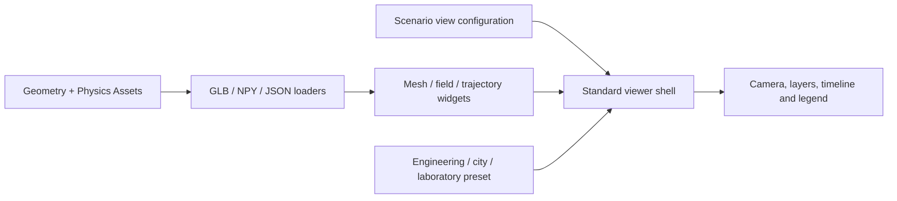

# Visualizer

[Canopy](../README.md) / Visualizer

Before adding a feature, read the [Visualizer contribution standard](CONTRIBUTING.md). [All component standards](../model/docs/framework/contributing.md) provide the shared entrypoint.

The Visualizer reads Geometry and Physics Assets through a single presentation framework. Scenarios choose a preset and default view; they share loaders, coordinate transforms, widgets and interaction controls. Opening a view performs no simulation.

## Internal structure



| Part | Location and role |
| --- | --- |
| Scenario catalog | [src/visualization/catalog/](src/visualization/catalog/) lists available scenes |
| Viewer shell | [src/visualization/viewer/](src/visualization/viewer/) coordinates rendering and interaction |
| Widgets | [src/visualization/widgets/](src/visualization/widgets/) adapt typed layers to scene objects |
| Shared utilities | [src/visualization/shared/](src/visualization/shared/) handle time, binary data, coordinates and presentation utilities |
| Read-only API | [canopy.visualization](../model/src/canopy/visualization/) resolves selected Scenario Assets |
| Compatibility website | [site/](site/README.md) preserves the detailed London presentation and resource paths |
| Overview diagram | [diagrams/architecture.svg](diagrams/architecture.svg) is editable SVG with accessible text |

## Fixed template, Scenario-specific defaults

`Scenario.visualization` selects `template:standard`, a preset (`engineering`, `city`, `laboratory`), Asset/layer references, time alignment and optional ENU camera coordinates. Geometry can be viewed on its own; physics layers can be added when available. The viewer accepts only supported formats and registered presentation behavior.

A widget loads its declared layer, creates render objects and responds to visibility/time changes. It preserves the layer's units, frame, masks and actual samples. Solver-specific computation belongs in a Model Method. New presentation behavior is added through the shared widget registry in [widgets/index.mjs](src/visualization/widgets/index.mjs), with a compatible exported layer contract.

Physical vectors remain ENU. Rendering converts coordinates consistently into Three.js space. Sparse trajectories interpolate only identities present in both adjacent frames; data outside the recorded range remains unavailable. Current volume visualization uses exported horizontal slices.

## Run and verify

After [installation](../model/README.md#run-the-small-example), run from the repository root:

```sh
canopy --root . serve --port 8769
node --test visualizer/tests/test_viewer.mjs
# In a second terminal; requires puppeteer-core and a local Chrome executable:
node visualizer/tests/browser_canopy_scenarios.cjs http://127.0.0.1:8769
```

Set `PUPPETEER_MODULE` and `CHROME_PATH` when those tools are outside the test defaults. The browser scenario check requires the retained London payloads and checks that London is the sole catalog entry. Synthetic browser checks can use the separate workspace printed by `model/tools/run_example.py`.

The local server explicitly maps existing `/src/visualization/`, `/project/`, `/examples/` and `/schemas/` URL prefixes to their current repository or data locations. The detailed website's `/viewer/`, `/scenes/`, `/assets/` and related paths map to `visualizer/site/`. These are public resource routes, independent of the source directory names. Source code, private configuration and arbitrary filesystem paths are not served.

The [interactive architecture guide](guide/README.md) lists the current Model, Asset and Visualizer contents and links to their extension standards. Open `/guide/` on the local server.
