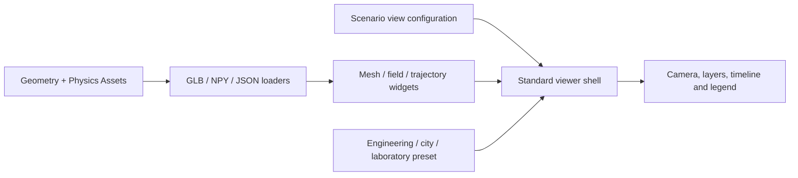

# Visualizer

[Canopy](../README.md) / Visualizer

Before adding a feature, read the [Visualizer contribution standard](CONTRIBUTING.md). [All component standards](../model/docs/framework/contributing.md) provide the shared entrypoint.

The Visualizer reads Geometry and Physics Assets. Its target is one presentation framework: Scenarios choose a preset and default view while sharing loaders, coordinate transforms, widgets and interaction controls. Opening a view performs no simulation.

The standard scientific Viewer and the detailed public London presentation currently have separate rendering paths. Review the [current architecture](docs/architecture-review.md) and [unified upgrade plan](docs/upgrade-plan.md) for their interfaces, the proposed common UI and performance work. Runtime consolidation is planned, not yet implemented.

The public presentation uses a minimal widget player: the original Overview / Traffic / Birds / UAV / field buttons above a full-page 3D view, with only play/pause and a progress slider below. Titles, Scenario navigation, side panels, legends, metrics and hover readouts are hidden. The local scientific Viewer retains its Scenario tabs and inspection controls; the two runtimes are still separate. Choose a public Scenario through its catalog link or direct URL.

Both the homepage download flow and the direct Viewer show a simple loading page: the Canopy wordmark, the selected Scenario title and short description, and a progress bar. Read the introduction from the public catalog. Show measured geometry-transfer progress when available and an indeterminate bar during preparation. The page uses no preview renderer and disappears when initialization completes.

## Internal structure



| Part | Location and role |
| --- | --- |
| Scenario catalog | [src/visualization/catalog/](src/visualization/catalog/) lists available scenes |
| Viewer shell | [src/visualization/viewer/](src/visualization/viewer/) coordinates rendering and interaction |
| Widgets | [src/visualization/widgets/](src/visualization/widgets/) adapt typed layers to scene objects |
| Shared utilities | [src/visualization/shared/](src/visualization/shared/) handle time, binary data, coordinates and presentation utilities |
| Read-only API | [canopy.visualization](../model/src/canopy/visualization/) resolves selected Scenario Assets |
| Compatibility website | [site/](site/README.md) preserves the detailed London presentation and resource paths |
| Overview diagram | [diagrams/architecture.svg](diagrams/architecture.svg) is editable SVG with accessible text |
| Static publication | [tools/build_pages.py](tools/build_pages.py) packages the shared website, guide and pinned Scenario data references |
| Remote verification | [tools/check_publications.py](tools/check_publications.py) verifies deployed manifests and, optionally, every remote payload |

## Fixed template, Scenario-specific defaults

`Scenario.visualization` selects `template:standard`, a preset (`engineering`, `city`, `laboratory`), Asset/layer references, time alignment and optional ENU camera coordinates. Geometry can be viewed on its own; physics layers can be added when available. The viewer accepts only supported formats and registered presentation behavior.

A widget loads its declared layer, creates render objects and responds to visibility/time changes. It preserves the layer's units, frame, masks and actual samples. Solver-specific computation belongs in a Model Method. New presentation behavior is added through the shared widget registry in [widgets/index.mjs](src/visualization/widgets/index.mjs), with a compatible exported layer contract.

Physical vectors remain ENU. Rendering converts coordinates consistently into Three.js space. Sparse trajectories interpolate only identities present in both adjacent frames; data outside the recorded range remains unavailable. Current volume visualization uses exported horizontal slices.

## Run and verify

After [installation](../model/README.md#run-the-small-example), run from the repository root:

```sh
canopy --root . serve --port 8769
node --test visualizer/tests/test_viewer.mjs
# In a second terminal; requires puppeteer-core and a local Chrome executable:
node visualizer/tests/browser_canopy_scenarios.cjs http://127.0.0.1:8769
# Uses isolated API fixtures; no retained London data required:
node visualizer/tests/browser_scenario_tabs.cjs http://127.0.0.1:8769
```

Set `PUPPETEER_MODULE` and `CHROME_PATH` when those tools are outside the test defaults. The browser scenario check requires the retained London payloads and checks that London is the sole catalog entry. Synthetic browser checks can use the separate workspace printed by `model/tools/run_example.py`.

The local server explicitly maps existing `/src/visualization/`, `/project/`, `/examples/` and `/schemas/` URL prefixes to their current repository or data locations. The detailed website's `/viewer/`, `/scenes/`, `/assets/` and related paths map to `visualizer/site/`. These are public resource routes, independent of the source directory names. Source code, private configuration and arbitrary filesystem paths are not served.

The [interactive architecture guide](guide/README.md) lists the current Model, Asset and Visualizer contents and links to their extension standards. Open `/guide/` on the local server.

The committed `main` source is built into [Canopy Pages](https://canopy-world.github.io/canopy/) and its [guide](https://canopy-world.github.io/canopy/guide/) together. Public payloads live in independent Scenario repositories; Canopy publishes a [Scenario link index](https://canopy-world.github.io/canopy/scenario-index.json), pinned references and the shared Viewer. Follow the [publishing standard](docs/publishing.md) for remote checksums, selected-Scenario caching, local preview and deployment.

The compatibility city viewer loads every detail tile while the building layer is enabled, shares compatible texture/material resources, and supports lossless `EXT_meshopt_compression`. Camera movement does not evict building tiles. Scenario data may set `birds_enabled: false`, `layers.solar.shadow_only: true`, and `corridor_context.crossings` to select compact presentation resources. Recorded SUMO vehicles interpolate position, shortest-turn heading and display elevation only between adjacent samples with matching identities; source samples remain unchanged.

Optional zebra crossing data declares OSM way identities, ENU paths and attribution. Only explicitly marked source ways are rendered, with illustrative stripe dimensions and a road alignment filter. These markings are context, not surveyed road geometry. The compact London snapshot rollout is tracked in [the rollout note](../scenario/imperial_corridor_8km/compact-rollout.md).

Ordinary roads use terrain DEM elevations for display, with lane spans resampled at most every 5 m and a 2.5 cm depth offset. Crossing paint and vehicle placement use the same terrain matching policy. Road display seams connect ordinary lane edges and junction boundaries to the terrain DEM. Explicit bridge, positive-level, tunnel and covered edges and their connected junctions are excluded. These seams are presentation geometry, not surveyed embankments or inferred bridge classifications; original lane elevations and recorded vehicle samples remain unchanged.

Crossing stripes retain continuous spacing across source polyline vertices and sit 15 mm above elevated lane surfaces. Their dimensions remain illustrative. Traffic signal lenses are unlit because this recording contains no signal phases; displayed vehicles replay the saved SUMO subset and do not respond to these static signal models.

Traffic replay uses monotone cubic display interpolation over adjacent recorded samples to smooth changes in speed and heading. It passes through every saved sample, bounds each coordinate to its interval endpoints, follows the shortest heading turn, and never extrapolates missing vehicles. This improves replay presentation; it does not rerun SUMO or establish the true path between one-second samples. Rendering performance remains device-dependent.

Vehicle bodies distinguish cars, taxis, buses, light/heavy goods vehicles and motorcycles. Replay metadata may supply `vehicle_types` dimensions in metres and `position_reference: "front_bumper"`; these take precedence over illustrative fallback dimensions. Legacy replays without a position reference retain their existing center placement. SUMO front-bumper positions are shifted to body centers only for rendering. No simulation coordinates are rewritten.

The experimental offline native-SUMO review uses
`site/viewer/3d/traffic-facilities.js` to display native stop lines, recorded
signal lamps and explicitly mapped OSM crossing markings. Its clock holds
actual switch states inside the recorded interval; missing/out-of-range states
stay dark. Zebra stripes and dotted/line boundaries retain distinct mapped
styles; fixture dimensions are illustrative. This presentation adapter is not
a registered Asset widget and does not replace the published London dataset.
See the [demo run guide](../model/traffic/demo/README.md) for source and export
requirements.

Native demo review groups lamps by incoming edge and identical recorded state
history, placing a representative fixture outside the leftmost lane. Different
state histories stay separate; this is schematic placement, not surveyed poles.
`native-road-surface.js` joins curved lane strip vertices and matches junction
boundary heights to explicitly connected lane ends. Markings follow the displayed
surface. This presentation correction preserves native samples and does not
repair the underlying SUMO elevation assumptions or certify network geometry.

The corridor Traffic focus opens at Exhibition Road near its Thurloe Place
junction in South Kensington (ENU east 1,876 m, north -1,248 m, relative to the
Scenario origin). The fixed camera stays there until the user navigates away.
This camera choice does not alter demand, recorded samples or vehicle routing.

### Native traffic and daylight playback

The Traffic widget selects the recorded South Kensington demonstration used in the review video: 410 native 0.1 s samples, native road heights, front-bumper geometry and synchronized recorded signals. It uses the shared renderer, camera and timeline. Surrounding buildings, mapped vegetation and the wider road network remain visible. Traffic uses the city's original flat datum because this recording contains relative OSM road heights, not DEM elevations; terrain relief returns on leaving Traffic. Within the recorded 350 m region, native roads and synchronized fixtures replace the older road and static-signal presentation using a world-space mask. The mask does not alter source geometry or trajectory samples. Overview remains the default. This is a local synthetic low-load demonstration, not an accepted full-city traffic model or capacity estimate. The public presentation adapter explicitly supports `experimental-offline-sumo-review-1`; it does not register this JSON as a V2 scientific Asset. The Traffic camera is raised to keep the junction readable between the surrounding facades. Native asphalt uses a depth bias against coplanar mapped paths, without changing recorded heights.

Run `node visualizer/tests/browser_traffic_city.cjs <built-site-base-url>` with `PUPPETEER_MODULE` and `CHROME_PATH` configured for real-data checks of city visibility, replay controls, terrain restoration, daylight bounds and tablet layout. Screenshots and the result report go to `cache/traffic-city/` (override with `CANOPY_QA_OUTPUT`).

Sunlight defaults to recorded samples with solar altitude above the horizon (frames 21–88 for this day). Original indices, times, all 100 payloads and quantitative values are unchanged. `solar_day=full` explicitly restores the full-day playback bounds. Both irradiance and shadow share those bounds; restarting playback returns to the first daylight sample.

The optional `scene.interior` preset adds **I-HUB Interior** immediately after
**White City campus** in the shared city viewer. It loads aligned `building` and
`office` GLB resources (optionally lossless gzip), preserves the full building shell,
and supports a timed exterior-to-interior camera journey. The optional
`journey.keyframes` uses presentation seconds and aligned camera positions and
targets; `camera.target` and `camera.position` remain the static fallback. Only `replace_asset`
is hidden while inspecting the interior; other city geometry remains visible.
The interior uses the original flat city datum, restoring terrain on exit.
The current journey approaches the office for 4 seconds and then explores the
common room until 30 seconds. Pause, seek and replay use the bottom controls;
dragging pauses the journey for manual inspection. Reduced motion opens at the
final indoor pose without automatic movement.
This retained v10 office is a concept layout, not a measured as-built interior;
its recorded geographic fit has a 1.58 m median residual. Payloads require a
separately approved Scenario snapshot; the code alone does not publish them.

Selecting **UAVs** frames the entire 8 km × 8 km domain from above using the current
viewport aspect ratio. UAV layers are hidden outside that widget. The network
uses 2.5 px lines and the selected route uses 5 px lines; recorded route coordinates
remain unchanged.
The pending interior preset is recorded in
[`scenario/imperial_corridor_8km/presentation/ihub-interior.json`](../scenario/imperial_corridor_8km/presentation/ihub-interior.json).
Copy that object into the next approved snapshot's `scene.json` as `interior`,
and include the two declared gzip resources in its checksum inventory.
