# Visualizer architecture review

[Visualizer](../README.md) · [Contribution contract](../CONTRIBUTING.md) · [Unified upgrade plan](upgrade-plan.md)

Baseline reviewed against Canopy source `4736907c95c58b0124b0860d9a63517d2895f809` on 18 November 2026, with subsequent navigation and minimal-player changes described below. This document describes the implementation; the upgrade plan describes work still to do.

Canopy should have one Viewer runtime shared by every Scenario. The repository currently has two rendering paths: the scientific Viewer backed by the local Python API, and the detailed public London presentation backed by static snapshots. They share some concepts and utilities, but do not yet share a complete runtime, layer lifecycle or interface.

The public city presentation now shows only its widget button row, full-page canvas and bottom play/pause + progress slider. Its previous detail controls remain in a hidden compatibility host because existing adapters still use them for state. The local scientific Viewer retains its [Scenario tab component](../src/visualization/shared/scenario-tabs.mjs) and inspection UI. Public Scenario selection uses catalog links or direct URLs. This presentation change does not consolidate the rendering runtimes.

## Current paths

```mermaid
flowchart TB
    subgraph SCI["Scientific presentation · local"]
        S["Scenario JSON + retained Assets"] --> API["Read-only Python API"]
        API --> V1["Standard Viewer\ncamera · clock · controls"]
        V1 --> W["Typed widgets\nGLB · NPY · JSON · trajectories"]
    end
    subgraph CITY["Detailed London presentation · public or local"]
        P["Pinned publication + snapshot"] --> ROUTER["Resource router + browser cache"]
        ROUTER --> CONFIG["Scene configuration + compatibility adapters"]
        CONFIG --> V2["City Viewer\ncamera · playback · controls"]
        V2 --> MODULES["Detailed geometry · fields\ntraffic · birds · UAV"]
    end
    subgraph GUIDE["Documentation"]
        INVENTORY["Generated component inventory"] --> WEB["Architecture guide"]
    end
    classDef scientific fill:#e7f2ef,stroke:#397b68,color:#142d25
    classDef public fill:#edf1f9,stroke:#566fa3,color:#1e2b43
    class S,API,V1,W scientific
    class P,ROUTER,CONFIG,V2,MODULES public
```

The architecture guide is a documentation website, not a third simulation Viewer. None of these pages runs a physics simulator.

| Path | Entry and implementation | Current responsibility |
| --- | --- | --- |
| Scientific | `/src/visualization/viewer/?scenario=<id>`; [viewer/main.mjs](../src/visualization/viewer/main.mjs) | Resolve selected Assets, construct typed widgets, fit camera, align time, inspect supported values |
| Read-only API | [server.py](../../model/src/canopy/visualization/server.py), [profile.py](../../model/src/canopy/visualization/profile.py) | Resolve Scenario metadata and exact retained run manifests; no simulation HTTP endpoint |
| Public city | `/viewer/3d/?scene=imperial_corridor_8km`; [3d/main.js](../site/viewer/3d/main.js) | Detailed London geometry, fields, camera tours, traffic, birds, UAV and city controls |
| Static data | [scene.js](../site/viewer/scene.js), [asset-router.js](../site/asset-router.js), [preload.js](../site/preload.js) | Resolve presentation configuration, declared remote resources and optional cached data |
| Documentation | `/guide/`; [guide/](../guide/README.md) | Explain ownership, component inventory, contracts and current limitations |

## Scientific Viewer

The Python profile returns Scenario identity, spatial metadata, view settings, run URLs and selected layer identities. The Viewer adapts those selections to the scientific run manifest. It also retains legacy scene/manifest entry paths.

The shell owns one Three.js renderer, camera, controls, clock and picking state. Widgets receive the scene, camera, manifest, bounded asset base URL and presentation helpers. The existing lifecycle is the starting point for unification:

| Call | Meaning |
| --- | --- |
| `load(context, layer, signal)` | Load a declared representation and attach render objects; honor cancellation |
| `setTime(seconds)` | Display the available recorded sample or supported interpolation |
| `setVisible(boolean)` | Toggle this layer without changing its scientific state |
| `setOpacity(number)` | Change supported display opacity |
| `pick(query)` | Return supported layer/run identity, position and field value with units, or `null` |
| `dispose()` | Release owned objects, resources and listeners |

See [the widget contract](../CONTRIBUTING.md), [binary dispatch](../src/visualization/widgets/binary.mjs), [trajectory widget](../src/visualization/widgets/trajectories.mjs) and [shared time helpers](../src/visualization/shared/time.mjs). The JSON widget registry alone does not install a binary loader: `createWidget` currently dispatches those implementations.

The scientific Viewer already renders on invalidation and during playback, and cancels scheduled work when hidden. It checks relative versus absolute time alignment and requires epochs where needed. It loads selected widgets sequentially. It has explicit disposal and a page-level abort signal; cancellation and resource release still need integration coverage during Scenario switching.

GLB, supported NPY/JSON fields, exported slices and sparse recorded trajectories are available. Arbitrary 3D volume slicing, a Zarr reader and a universal static V2 publication adapter are not implemented.

## Detailed London Viewer

The public Viewer loads a static scene catalog, then its scene configuration and logical resource routes. A generated mapping connects those routes to the exact files in the pinned independent data repository. Existing `presentation` and `run` query adapters support additional compatibility inputs; they are not a complete V2 static Source interface.

The city entry module mixes renderer setup, camera tours, layer controls, field playback, prefetching and Scenario-specific decisions. Several modules communicate through window globals. City modules do not all implement the scientific widget lifecycle.

For example, [complete-detail-tiles.js](../site/viewer/3d/complete-detail-tiles.js) exposes `ready`, `group`, `progress`, `hasPoints`, `update` and `setEnabled`, rather than the standard widget contract. It uses three concurrent loading workers and retains the complete source meshes and transforms. It has no public `dispose()` or runtime tile eviction. The full-detail path must remain available during migration.

There are already performance measures worth retaining: bounded detail loading, static matrices, field prefetch, compressed payloads and conditional drawing. The city loop schedules animation frames continuously, but calls the renderer only when its dirty/motion conditions require it. Describing this as unconditional rendering would be inaccurate.

The static scene resolver now rejects an unknown `scene` with an explicit error instead of falling back to London. The error panel offers retry, lightweight geometry and the catalog link for recovery. Future Source adapters must preserve this behavior.

## Data delivery and scale

The London snapshot contains **1,477 payloads / 558,073,283 stored bytes**. The shared website remains about 5 MB. These are stored sizes, not decoded RAM or GPU estimates.

The opening page verifies and caches the selected Scenario's full download list before entering the Viewer. The direct Viewer URL loads requested resources without this mandatory complete download, although its complete-geometry mode still requests the full geometry set. Offline download should become an explicit action in the unified UI.

The service worker already restricts remote reads to declared HTTPS roots, omits credentials, preserves Range requests and uses bounded transient retries. These protections and snapshot/hash identities should be retained beneath the shared Source interface. See [publication and caching](publishing.md).

## What to keep, what to consolidate

| Concern | Keep | Consolidate |
| --- | --- | --- |
| Scientific meaning | ENU transforms, units, masks, source samples, actual bounds and provenance | One normalized descriptor that preserves these meanings across both sources |
| Layer behavior | Existing scientific widget lifecycle and city capabilities | Explicit registry, predictable ownership and disposal for every layer |
| Runtime | Three.js, camera utilities, picking, shared time helpers | One renderer, one clock, one selection model and one invalidation scheduler |
| User interface | Widget selection, recorded progress, accessible controls and detailed scientific metadata | One minimal presentation shell; keep inspection UI separate from the public canvas |
| Performance | Compression, batching, bounded loading and field prefetch | Shared request/decode budgets, visible-data priority and bounded memory |
| Scenario variation | Declarative view selection and small presets | Remove Scenario-ID branches and global cross-module control as layers migrate |

The next step is the [unified upgrade plan](upgrade-plan.md): one runtime, two data-source adapters, shared layer plugins and small declarative presets. The plan covers architecture, UI and performance together; it does not label that consolidation as already shipped.
