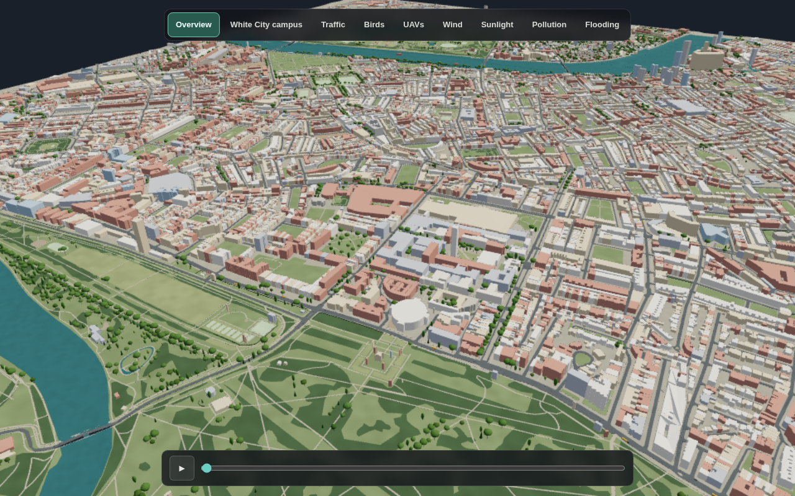
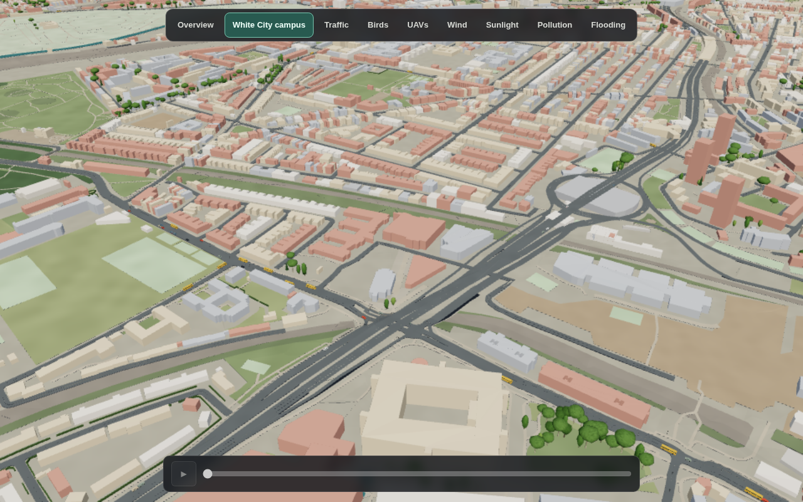

# Loading, widget switching and display geometry

[Visualizer](../README.md) · [Architecture](architecture-review.md) · [Contribution standard](../CONTRIBUTING.md)

Reviewed against source `d020c0b` and the pinned `london-public-20261118` snapshot. The changes below are proposed in a PR. New display exports are local review candidates; the published snapshot and registered scientific Assets remain unchanged.

## What the Visualizer contains

| Component | Implementation | Cost and ownership |
| --- | --- | --- |
| Entry and delivery | `site/preload.js`, `asset-router.js` | Scenario selection, declared HTTPS resources, optional verified offline cache |
| Public shell | `site/viewer/3d/main.js` | One renderer, camera, widget selection, playback and field textures |
| Buildings | Overview GLB, `complete-detail-tiles.js` | Overview geometry or explicitly requested complete detail; full detail has no eviction |
| Ground and street context | `corridor-terrain.js`, `vector-landscape.js`, `corridor-context.js` | DEM, road index, land-cover geometry, instanced trees, street furniture and recorded traffic |
| Physics frames | `npy.js`, `compressed-assets.js`, `frames.js` | Range/chunk reads, decompression, optional PNG decoding and frame caches |
| Animated actors | Traffic, birds and UAV adapters | Recorded trajectories and actor meshes; each adapter still has some private playback state |
| Scientific Viewer | `src/visualization/viewer/`, `widgets/` | Separate local API runtime, typed widget lifecycle, on-demand drawing and three-frame NPY source caches |

The public and scientific paths are still separate runtimes. This change does not claim to unify them. The public runtime is the main source of the reported London loading and switching costs.

## Confirmed causes

1. The homepage previously downloaded and verified all **558,073,283 bytes of Scenario data**, plus the frontend, before opening a view. Much of that data was unrelated to the selected widget.
2. Sunlight and flood playback used `compactFrame()` to decode the entire sequence before showing the requested frame. Summer sunlight alone allocated `99 × 1024 × 1024 × 4` bytes, or **396 MiB**. Switching away did not cancel that whole-sequence work. A fading old layer could start another sequence preparation.
3. Complete geometry retained every detail tile and landmark. The 331 compressed detail GLBs contain **11,613,551 triangles, 6,164 primitives and 3,011 embedded images**, totalling 139.52 MB compressed and 534.87 MB decompressed GLB bytes. These are file statistics, not total GPU memory. The rest of the detail inventory adds other resources.
4. Ground geometry was subdivided and its normals calculated on the browser's main thread. The Viewer retained separate flat and elevated geometry. Detailed instanced vegetation keeps draw calls low but still submits many triangles.
5. The NPY frame cache allowed 200 MiB on every device. The compressed reader has another 64 MiB cache. Legacy PNG playback has separate caches; those are not the active path for the pinned London fields.
6. Paused birds and selected UAVs could still invalidate drawing without advancing their recorded clocks.

## Changes in this PR

- The normal homepage streams the selected view. `?download=all` explicitly requests the existing complete, checksum-verified offline package.
- Balanced geometry is the default: use the overview buildings and simpler tree crowns. `?quality=full&lite=0` keeps the original complete-detail inspection mode. `?lite=1` retains the voxel fallback. No source geometry is deleted.
- Sunlight and flood use the same demand-driven frame path as the other fields. Fetch the current frame and two following frames; keep the original spatial grids, masks, values and saved timestamps.
- The NPY cache is bounded by bytes: 64 MiB on larger devices, 32 MiB when the browser reports at most 4 GB of device memory. Changing sources releases unrelated frames. Late obsolete loads cannot repopulate the cache. In-flight requests, retained per-layer arrays and textures use additional memory outside this cache limit.
- Hidden readouts no longer cause the first frame of every physics layer to load. Returning to a city widget clears the field frame cache and invalidates obsolete display requests.
- Paused birds and UAVs no longer request redundant redraws from their time-update paths. The city animation scheduler still runs; full runtime scheduling consolidation remains future work.
- A separately declared display export can supply preprocessed buildings, ground and compact placement metadata. It is never substituted for computational geometry or used to rerun physics.

## Measurements and limits

One local Chrome run at 960 × 640 used real published London data. Continuous drawing was paused because this workstation uses software WebGL. Heap observations were taken after explicit garbage collection. They include browser-reported JS/external array memory, not total process RSS or GPU memory. Network conditions were not controlled; the timings are observations, not performance guarantees.

The following comparison isolates the frame-loading change with the **same existing voxel geometry and ground** on both sides:

| Observation | Before | After frame-loading change |
| --- | ---: | ---: |
| Requests for the first summer sunlight selection | 99 frames | 3 frames |
| First sunlight switch including measurement overhead | 5.16 s | 0.16 s |
| Reported used memory after first sunlight selection | 1,129 MiB | 669 MiB |
| NPY retained frame budget | 200 MiB | 64 MiB on this device |

The derived geometry preview was measured separately, with different geometry. It reported approximately **337 MiB after loading and 348–360 MiB during the tested field switches**, with approximately 176 MiB of geometry attribute/index buffers reachable from the scene. It is not an isolated cache benchmark. Detailed findings are kept in the local `cache/visualizer-audit/` review directory. A real GPU, mobile device and throttled connection still need performance measurements before setting FPS or memory targets.

## New display exports

The generator reads only checksum-verified files from an immutable published snapshot and refuses to overwrite an output directory. It records source file hashes, the source manifest hash, the generator hash, parameters and output hashes in `provenance.json`.

| Candidate | Result |
| --- | --- |
| Overview buildings | Gzip transfer decreases from **9.76 MB to 3.50 MB**; primitives decrease from **632 to 95** while preserving the 95 source mesh nodes |
| Building shape | 1,599,944 → 1,592,492 triangles; conservative simplification preserves borders. The requested 50% ratio was not reached and is not claimed |
| Building encoding | Palette materials and Meshopt compression; 16-bit positions. Accessor storage grows from 16.65 to 20.60 MB because palette UVs are added. The runtime avoids expanding and rebatching the preprocessed mesh |
| Ground | An ordinary elevated GLB with precomputed normals; adaptive subdivision up to 40 m, finer near changing elevation, 16-bit positions and 8-bit normals |
| Ground flattening | An additional centimetre-encoded height attribute supports the existing flat physics presentation; external GLB viewers show the elevated surface without a custom shader |
| Placement metadata | Original tree seeds, hedge paths and street fixtures in **0.48 MB gzip**, excluding unrelated source metadata |

The final compressed building, ground and placement files total **17.77 MB**, including **13.79 MB** for the preprocessed ground. This is a display package, not the total download or memory of a running Viewer. Physics, roads and actor data remain separate.

The review images below were captured from the actual local Viewer with the candidate assets:





Ground interpolation is checked at triangle edge midpoints and centroids against the original DEM sampler. Refinement targets 0.5 m sampled vertical error with a 5 m stopping edge. The largest sampled error in this export is approximately **0.74 m before final position quantization**. This is not a global or surveyed accuracy bound. Position quantization, interpolation and shading are display transformations, and their precision is recorded separately. Buildings, roads, source elevations and physical fields are retained unchanged in the source snapshot.

The exporter produces a display derivative with provenance, not a registered V2 scientific Asset. Publishing or registering it requires a separately reviewed data change with the complete Asset and publication descriptors. Do not edit the existing immutable snapshot or point simulators at these display meshes.

## Reproduce the export and preview

Use Node.js 22 or later. Install the locked offline preparation dependencies; they are not shipped to browsers:

```sh
npm ci --prefix visualizer/tools/display-assets
node visualizer/tools/build_display_assets.mjs \
  --source /path/to/canopy-scenario-imperial-corridor-8km/snapshots/london-public-20261118 \
  --output cache/london-display-review \
  --dependencies visualizer/tools/display-assets
python visualizer/tools/build_pages.py --refresh
python visualizer/tools/preview_display_assets.py \
  --snapshot /path/to/canopy-scenario-imperial-corridor-8km/snapshots/london-public-20261118 \
  --display cache/london-display-review \
  --output cache/display-preview/canopy
python -m http.server 8769 --directory cache/display-preview
```

Open `/canopy/viewer/3d/?scene=imperial_corridor_8km&lite=0&play=0`. This is an isolated **online-only** preview; it redirects the existing public resource routes to the candidate display files locally. The preview is not a publishable Pages artifact or a complete offline package. Full detail remains available through `quality=full` and reads the original assets.

The optional `scene.json` field `display_assets` declares `buildings`, `buildings_bytes`, `ground` and `placements`. Paths resolve through the existing declared resource router. Generated `scene-display.json` shows the values. Unsupported ground height metadata fails explicitly instead of silently applying another scale.

## Verification and next priorities

Validation passed: 77 Model tests, 19 JavaScript tests, nine Pages tests, the protocol fixture and repository inventory checks. Browser checks covered normal and derived entry, three initial sunlight frame requests, 18 repeated field switches within the cache budget, and field-cache release on return to Traffic. Desktop and mobile layouts passed playback, pause, seeking, last-sample restart and rapid selection checks. Complete-detail inspection loaded all 331 GLBs; the full offline package passed file verification and an offline reload.

The generated building and ground GLBs produced no validator errors or warnings. The validator reports that it cannot validate Meshopt-compressed contents; decoded NodeIO round trips and actual Three.js rendering supplied that additional check. These are functional checks and local observations, not real-device FPS benchmarks.

Run the usual repository, Model and Viewer checks, then the focused browser checks:

```sh
node --test visualizer/tests/test_*.mjs
node visualizer/tests/browser_loading_budget.cjs http://localhost:8769/canopy/
CANOPY_QA_LITE=0 node visualizer/tests/browser_widget_player.cjs http://localhost:8769/canopy/
```

On software WebGL hosts, `CANOPY_QA_PAUSE_RENDER=1` makes the widget test pause continuous rendering and explicitly capture frames. Report that limitation. The loading-budget check always pauses drawing and asserts request counts and cache bounds rather than fragile latency thresholds.

The next substantial improvements are spatial ground/road tiles with visibility culling, streamed complete-detail tiles with disposal, chunked bird replay instead of one large buffer, and worker-side field coloring. The existing full-detail loader should gain an explicit lifetime and eviction policy before becoming an automatic close-up level of detail. A global memory budget across geometry, textures, replay and field caches is still needed.

Compression and rendering cost must be tracked separately. Meshopt reduces transfer size; reducing triangle counts and draw calls improves rendering, while disposing owned geometry, textures and image bitmaps releases GPU and CPU resources. See the primary references: [glTF Transform](https://gltf-transform.dev/cli), [Three.js geometry batching](https://threejs.org/manual/pages/optimize-lots-of-objects.html) and [Three.js resource disposal](https://threejs.org/manual/pages/how-to-dispose-of-objects.html).
