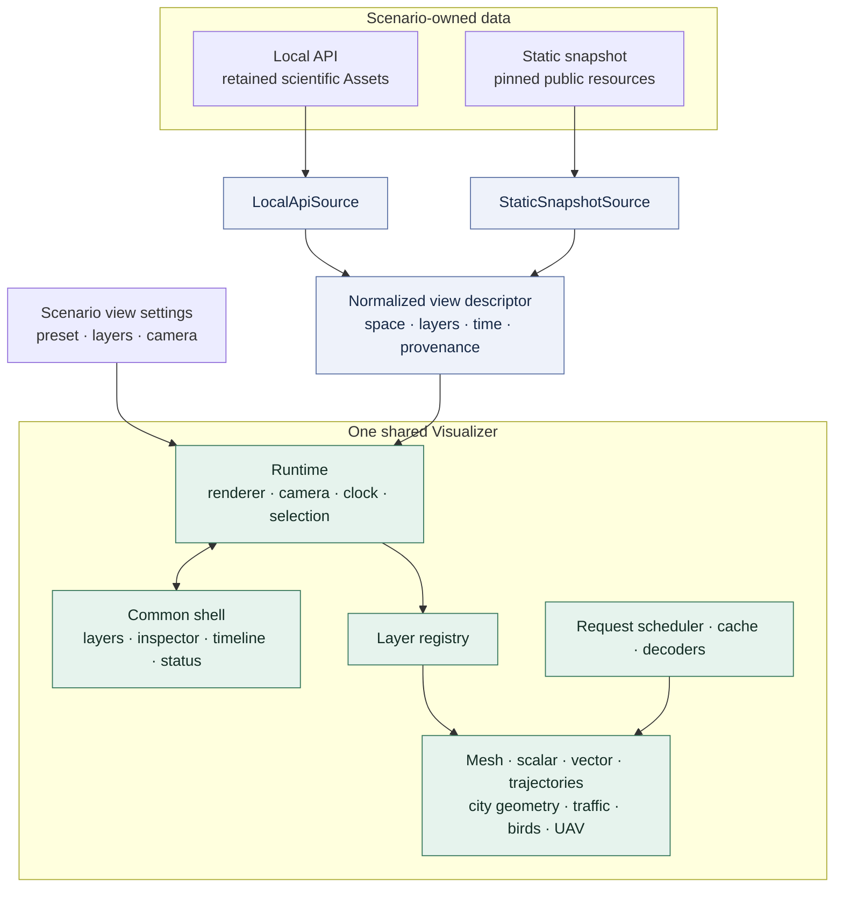

# One Visualizer for every Scenario

[Current architecture](architecture-review.md) · [Visualizer standard](../CONTRIBUTING.md) · [Scenario tutorial](https://github.com/CANOPY-WORLD/canopy-scenario-guide)

Status: **target architecture for review; runtime consolidation is not implemented**. This plan applies to the scientific Viewer and the detailed public city presentation. Scenario data remains independent, and the business domains stay `model/`, `scenario/`, `asset/` and `visualizer/`.

## Shared runtime, explicit sources



Sources translate storage and publication metadata. Layers translate declared data into render objects. The runtime coordinates display. The UI operates on runtime state. Model Methods continue to execute outside the Viewer and export Assets; opening the Viewer never starts computation.

The existing scientific shell and widget lifecycle are the starting point. A Source adapter must explicitly support each legacy encoding; matching file extensions alone is insufficient. In particular, a London presentation inventory cannot be relabeled as a scientific Asset manifest.

## Proposed internal boundaries

These are migration destinations, not directories that already exist. Move code in small reviewed steps and preserve public entry URLs with thin adapters during the transition.

```text
visualizer/src/visualization/
  viewer/       # Shared entrypoint and application assembly
  runtime/      # Renderer, camera, time, selection, invalidation, lifecycle
  sources/      # Local API and pinned static snapshot adapters
  layers/       # Registered presentation plugins, including migrated city layers
  data/         # Bounded fetch scheduling, byte cache and decoding workers
  ui/           # Shared controls, panels and accessible status feedback
  presets/      # Small declarative engineering, city and laboratory defaults
  shared/       # Coordinate, time and representation utilities
```

| Boundary | Proposed interface | Required behavior |
| --- | --- | --- |
| Source | `open(selection, signal) -> ViewDescriptor`; `dispose()` | Resolve one exact Scenario/snapshot; validate declared capabilities; never fall back to another Scenario |
| Descriptor | Scenario identity, spatial frame, layer/run/Asset references, time domains, resource references, capabilities | Keep source identity, transformation provenance, masks and sample times; unknown metadata stays unknown |
| Registry | `register({id, supports, create})`; explicit lookup | Select only supported layer/encoding pairs; reject ambiguity and unsupported representations |
| Layer | Existing `load`, `setTime`, `setVisible`, `setOpacity`, `pick`, `dispose` | Use the common lifecycle; release resources on Scenario changes; no independent renderer or animation loop |
| Runtime services | Clock, selection, invalidation, bounded data access and presentation helpers | Supply owned services through context; replace cross-module window globals |
| Preset | Initial layout, enabled tools, styles and camera defaults | Declarative, validated and small; no embedded solver or arbitrary Scenario script |

New Source/registry/context APIs require implementation and tests before external plugins can depend on them. Keep the existing widget interface stable or supply a documented adapter. Widgets must request redraw through the runtime; they must not introduce their own perpetual animation loops.

## Simple interface: Scenario tabs above one view

The primary navigation is a horizontal row of Scenario tabs generated from the catalog. The current catalog shows only London; do not add placeholder cases. Clicking another tab selects that case's data, layers and camera defaults in the same presentation structure. Keep deep links, browser history and open-in-new-tab behavior.

The current navigation component is shared by both existing Viewer paths. Switching currently navigates to the selected URL and releases the outgoing page; seamless in-page loading belongs to the later runtime consolidation. The public city's camera/field shortcuts are grouped under **Views and playback** in the side panel.

Keep the interface small:

```text
+--------------------------------------------------------------------+
| Canopy     [ London ]  [ other admitted Scenarios, when available ] |
+------------------------------------------------+-------------------+
|                                                | Layers / settings |
|                     3D view                    | Views & playback  |
|                                                | Selection details |
+------------------------------------------------+-------------------+
| Play / pause     Recorded time     Scrubber     Availability        |
+--------------------------------------------------------------------+
```

Presets remain internal configuration defaults. They do not need another top-level switcher or separate application. Engineering, city and laboratory may choose initial layers or styles; every Scenario retains the same frame. Show inspection details when an object or value is selected instead of adding a permanently open inspector by default.

Layer states should distinguish loading, ready, unavailable at this time, unsupported format and failed resource. Partial failure leaves usable layers available. The inspector should expose scientific meaning without requiring users to read internal paths. Empty time intervals must remain visible as unavailable, rather than being filled with invented samples.

On narrow screens, Scenario tabs scroll horizontally and the side panel folds behind a Layers button while the timeline remains reachable. Support keyboard selection, visible focus, readable units, reduced motion and non-color-only status. Preserve selected Scenario, snapshot and supported view settings in shareable URLs without credentials or private filesystem paths.

## Performance with explicit fidelity

1. **Browse before downloading everything.** Show available coarse/context geometry while visible detailed data loads. Make complete offline download an explicit, progress-reporting action.
2. **Budget work centrally.** Bound simultaneous transfers, decoded field frames and GPU residency. Prioritize visible layers, the current time and a small look-ahead window; cancel obsolete requests when changing Scenario or time.
3. **Move expensive decode work off the UI thread.** Use workers where the decoder supports them, with bounded buffers and ownership of transferable arrays. Measure both decode time and peak memory.
4. **Keep rendering driven by changes.** Build on the scientific Viewer's existing invalidation scheduling. Request frames while playback, camera movement or a layer animation needs them; suspend unnecessary work on hidden pages.
5. **Preserve complete geometry as a mode.** Keep source meshes, coordinate transforms and the current full-detail London capability. Optional display LOD/eviction must report display fidelity and must not change the underlying simulation data. Do not discard coarse coverage before replacements are ready.
6. **Release everything predictably.** Scenario switching must abort fetch/decode work, dispose GPU resources and remove event handlers. Version caches by Scenario and immutable snapshot; never reuse data from a different case by route accident.

Record a baseline before choosing numerical budgets. Measure cold/warm first visible geometry, time to complete selected layers, transferred bytes, decoded memory, estimated GPU bytes, p95 frame time during a defined interaction and idle rendering. Keep device, browser, network and selected fidelity with each result. Software-rendered CI can check behavior; it is not a representative interactive GPU benchmark.

## Implementation sequence and acceptance

| Stage | Deliverable | Acceptance |
| --- | --- | --- |
| 1. Baseline and contracts | Record current London/scientific behavior; specify normalized descriptor and Source errors | Reproducible layer inventory, coordinates/time checks and performance traces; no payload rewriting |
| 2. Shared source boundary | Local API and static snapshot adapters feeding the existing scientific runtime | Both sources load equivalent tiny fixtures; unsupported formats and unknown Scenarios fail explicitly |
| 3. Layer consolidation | Adapt detailed geometry, fields and recorded actor modules to the common lifecycle | London capabilities and complete-geometry mode preserved; one renderer/clock; no plugin-owned loops or window-global control |
| 4. Common shell | Layer tree, inspector, timeline, loading/errors and three declarative presets | Same controls across sources and test Scenarios; keyboard and mobile checks pass |
| 5. Resource budgets | Shared fetch/decode scheduling, progressive loading and bounded memory | Measured improvement against the baseline; repeated Scenario switches leave no accumulating resources |
| 6. Cutover | Route existing public/local URLs through the shared runtime; retire duplicate implementation after parity | Published London and local scientific results pass the same contract and browser checks; rollback remains available |

UI prototyping and performance measurement can begin during the Source work. They must converge on the common runtime rather than create an additional Viewer.

Use at least two tiny isolated test Scenarios to prove configuration independence. They remain fixtures, not additional curated public cases. London's `imperial_corridor_8km` remains the only registered real case until a separate Scenario admission PR is accepted.

The release checks must cover coordinate transforms and vertical datums; field units and masks; first/last recorded times; sparse identity interpolation; identical Asset/snapshot selection after reload; supported format rejection; per-Scenario cache isolation; canceled requests and disposal; existing complete London geometry; field values and source hashes; offline reload; accessibility; and representative hardware measurements. Compare actual samples, not just screenshots.

## Extension rule for contributors and agents

Add a representation reader when a new encoding is necessary, a shared layer plugin when new display behavior is necessary, or a small preset when only presentation defaults differ. A new Scenario contributes declarative configuration and its own Assets. It must not copy a Viewer, instantiate a second renderer, hardcode its ID in the runtime or embed physics execution in a layer.

Follow the [current contribution contract](../CONTRIBUTING.md) until each proposed API is implemented. The [Scenario guide](https://github.com/CANOPY-WORLD/canopy-scenario-guide) explains the working local workflow and the separate publication/PR path without assuming this migration has already happened.
